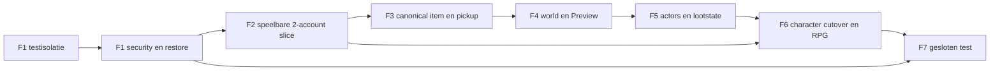

# GK MMORPG-basis v2.3 - Actief masterplan

> **GESLOTEN op 26-10-2026.** Dit plan is vervangen door [Werkbank-plan](../Werkbank-plan/WERKBANK-PLAN.md). Hier niet verder bouwen; alleen nog naslag.

**Status:** Fase 01 voltooid op 24 oktober 2026 (Kevin-akkoord; zie `README/fases/evidence/MMORPG-v2/F1/VOORTGANG.md`). Fase 02 is de volgende. **Auditbasis:** GitHub `main` zoals geinspecteerd op 23 oktober 2026; de oorspronkelijke referentiecommit was `8a976e346fcadf2f2a9fbced13b8ed48269df4d2`. Controleer de actuele HEAD vóór elke codeopdracht. Deze documentatiecommit verandert geen gamecode of database.

> **Eén actieve route:** begin bij [START-HIER](START-HIER.md) en geef een codeeragent één **faseopdracht**. De agent gebruikt de taakkaarten intern in afhankelijkheidsvolgorde en levert kleine, controleerbare wijzigingen; Kevin hoeft niet 87 opdrachten uit te sturen. De vijf documenten in `README/fases/MMORPG-basis/` en de eerdere auditregisters zijn **historische broninformatie, niet normatief voor agents**. Zij mogen geen scope, exitcriterium of technische verplichting toevoegen aan v2.3. Er worden geen oude repo-bestanden verwijderd; F1-E0-T03 markeert ze in de fase-index als historisch. Bij een inhoudelijk conflict: Kevins expliciete besluit -> actieve ADR -> dit masterplan -> actieve taakkaart. Een oude fase is nooit een fallback-contract.

## Doel en bewijs

Een MMORPG-basis is hier een kleine, veilige, door Kevin bewerkbare online RPG: twee accounts spelen een zichtbare kill-loot-questlus in dezelfde gepubliceerde wereld; de server beslist over gameplay; een beperkte RPG-lus overleeft restart; chat/party en herstel zijn klaar voor een **kleine gesloten test op gemeten capaciteit**. Dit is geen commerciële launch of belofte van 200 CCU.

De repo heeft al browser-Three.js, Node HTTP/WebSocket en SQLite (`package.json`, `src/server/server.js`, `src/server/db.js`), graph-authoring/publish (`src/server/graph-repository.js`, `src/server/publish-service.js`) en node03/04/05 gameplay (`src/server/node03-runtime-service.js`, `src/server/node04-quest-runtime-service.js`, `src/server/node05-economy-runtime-service.js`). Dat is bruikbare code, maar niet het bewijs dat de zeven doelen al veilig of performant zijn. De eerdere clone kon hier niet worden uitgevoerd; de tests en echte hostmeting zijn nog niet gedaan.

## Niet-onderhandelbare grenzen

1. **Testisolatie komt vóór testuitvoering.** F1-E0-T02 is de eerste actieve codekaart en schermt opslag/poort af. Kevin wil geen publieke root `.gitignore`; de eerdere ignore-kaart is daarom vervallen. Geen test op productiegegevens en geen geheimen of lokale DB in commits.
2. **Een gameplaywriter per domein.** Legacy graph is tot de betreffende canonical cutover de contentwriter; daarna alleen canonical commands. Inventory/equipment blijven in F5 op één legacy-schrijfpad en gaan in F6 per domein over. Geen dual-write en geen fysieke nodeverwijdering in dit plan.
3. **Server-authority.** Browserwaarden zijn intenties, nooit waarheid over positie, hit, loot, XP, currency of quest. De tijdelijke legacy WS/HTTP-game-ingangen sluiten hun mutaties uiterlijk bij F6-exit (F6-E3-T04).
4. **Bewezen resultaat per fase.** Een schema of groene unit-test zonder echte route voor Kevin is niet voldoende. Meetwaarden hebben ruwe samples, host/scene/build en een NO-GO als de poort faalt.
5. **Durability zonder schijnzekerheid.** Eerst sync-writekosten meten. De kleine, vrijwillige gesloten test mag WAL+NORMAL gebruiken na expliciet Kevin-akkoord over mogelijk verlies van recente geackte voortgang bij OS-/stroomuitval. Applicatiecrash, hostcrash en diskverlies zijn verschillende gevallen. Backups zijn noodzakelijk, maar voorkomen recent dataverlies niet volledig. Geen betaalde waarde in deze test. Zie [ADR-004](ADR/ADR-004-persistentie-en-economie.md) en OB-07.

## Zeven resultaatfases

| Fase | Wat Kevin zelf ziet | Harde poort | Ruwe duur* |
| --- | --- | --- | --- |
| [01 Veiligheid en bewijsbasis](FASE-01-veiligheid-en-bewijsbasis.md) | Twee bestaande accounts, cheatweigering, werkende restore | Isolatie eerst; daarna tests/security/restore | 2-4 weken |
| [02 Speelbare verticale slice](FASE-02-speelbare-verticale-slice.md) | Samen kill -> loot -> quest -> restart | 25 bots/30 min, 20 Hz, exacte receipts, gemeten DB-kosten | 5-8 weken |
| [03 Canonieke authoring en builds](FASE-03-canonieke-authoring-en-builds.md) | Project, item en pickup zonder Nodes publiceren en spelen | Drie parityrapporten, een writer, immutable release/rollback | 5-8 weken |
| [04 Wereld en PlayPreview](FASE-04-wereld-en-playpreview.md) | Twee Regions tekenen, grens lopen, veilig previewen | Collision/streaming/Preview-isolatie en framebudget | 5-8 weken |
| [05 Actors en combatcontent](FASE-05-actors-en-combat-content.md) | Enemy/resource maken, fight/loot/respawn | Determinisme, lootclaim/expiry-migratie, geen dubbele writers | 6-10 weken |
| [06 Character en RPG-lus](FASE-06-character-en-rpg-lus.md) | Twee gescheiden characters en volledige kleine RPG-lus | Per-domein migration/fence, 10 loops, legacy game-ingangen dicht | 6-10 weken |
| [07 Gesloten test en live-operatie](FASE-07-gesloten-test-en-live-operatie.md) | Chat/party, dashboard, herstel en vijf echte testers | Soak/cap, rollback, moderatie, privacy en OB-07-akkoord | 5-8 weken |

* **AANNAME:** één engineer met AI-agents en Kevins review, geschikte testcontent/host en geen grote verborgen productiefouten. De 87 taakkaarten zijn kleiner geworden door splitsing, niet doordat de productscope groeide. Doorlooptijden zijn geen toezegging; na elke fase opnieuw ramen.

## Architectuurkeuzes

- [ADR-001](ADR/ADR-001-scope-en-volgorde.md): eerst veiligheid en speelbare slice, daarna authoring.
- [ADR-002](ADR/ADR-002-modulaire-monoliet-en-sqlite.md): modulaire monoliet, SQLite, DB-worker alleen bij gemeten bottleneck.
- [ADR-003](ADR/ADR-003-authority-netcode.md): 20 Hz sim, JSON WS v1, AOI, sluit legacy game-ingangen bij F6.
- [ADR-004](ADR/ADR-004-persistentie-en-economie.md): atomaire receipts, WAL+NORMAL als expliciet beperkt testbeleid, geen ongefundeerde stroomuitvalgarantie.
- [ADR-005](ADR/ADR-005-content-en-cutover.md): canonical per domein met parity, immutable build, geen graphdrop.
- [ADR-006](ADR/ADR-006-world-en-instances.md): Region/Area/Cell, één world-owner en geïsoleerde Preview.
- [ADR-007](ADR/ADR-007-identiteit-en-security.md): account/character/sessie gescheiden, bestaande `selected_character_id` niet hergebruiken.
- [ADR-008](ADR/ADR-008-releases-en-operatie.md): pinned releases, drain, backup en geteste rollback.
- [ADR-009](ADR/ADR-009-privacy-en-social.md): kleine socialscope en privacyreview vóór externen.
- [ADR-010](ADR/ADR-010-capaciteit-en-kosten.md): gemeten CCU, admission cap maximaal 60% van geslaagde soak.

Ontwerpwaarden zijn nog geen codefeiten: 20 Hz fixed simulation, 64 KiB WS-max, JSON v1, 64 m AOI-cel, self/near/far 20/10/2 Hz en positiecheckpoint <=5 s. Hit-rewind, binaire codec, guild, market, volledige UI Studio, multi-host en fysieke nodeverwijdering zijn niet in deze basis. Een verandering vereist een nieuwe ADR en een meetbare spelerreden.

## Mijlpalen en kritisch pad

| Mijlpaal | Resultaat |
| --- | --- |
| M0 na F1 | Veilige bestaande demo, geïsoleerde suite en bewezen restore. |
| M1 na F2 | Echte twee-account slice met 25-botmeting en procescrash-receipts. |
| M2 na F3-F4 | Kevin kan item/pickup en wereld zonder Nodes bewerken, previewen en publiceren. |
| M3 na F5-F6 | Interne alpha: actorcontent en twee gescheiden characters met kleine RPG-lus. |
| M4 na F7 | Vijf-testersessie onder gecertificeerde cap, met moderatie/privacy/rollback. |

**Kritiek pad:** F1-E0-T02 -> F1-E2-T00 -> F1-E2-T02/T03 en F1-E1-T01..T04 -> F1-E3-T01/T02 -> F2-E1-T01..T05 -> F2-E2-T04..T08 -> F2-E3-T01..T03 -> F3-E1/E2 -> F3-E3-T02/T04..T08 -> F4-spatial/Preview -> F5-E2-T03/T05 -> F6-E1-T01/T04..T13 -> F6-E2/E3 inclusief T04 -> F7 staging/soak/gesloten test. Dit is een afhankelijkheidsroute, geen opdracht om kaarten in één PR te bundelen.

## Werkwijze voor Codex of Claude

Geef **één faseopdracht tegelijk** plus [START-HIER](START-HIER.md), het relevante FASE-bestand en de ADR's die de fase raken. De agent doorloopt kaarten intern in afhankelijkheidsvolgorde, houdt wijzigingen klein en rapporteert voortgang en blockers; Kevin hoeft niet per kaart een nieuwe prompt te geven. Laat de agent eerst de actuele repo/HEAD en bestaande wijzigingen lezen. De oplevering toont gewijzigde paden, testcommando's en ruwe output, before/after gedrag, datarisico, rollback en een concrete Kevin-handtest. De agent mag geen oude fasecontracten als implementatiespecificatie gebruiken, geen extra fase verzinnen en geen NO-GO-gate afvinken met alleen documentatie. Kevin sluit iedere fase pas na zichtbare eigen controle.

Zie verder [risicoregister](RISICOREGISTER.md), [open beslissingen](OPEN-BESLISSINGEN.md) en [reviewcorrecties](REVIEW-CORRECTIES.md). De eerdere inventaris, volledige Claude/DeepSeek-tabel en 795-regelige mapping blijven archief bij de vorige levering en maken **geen deel uit van deze actieve werkset**.
